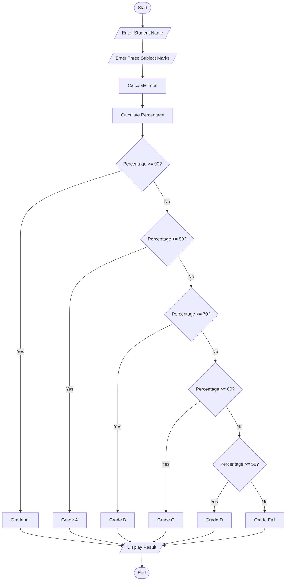

# Student Grade Calculator

## Project Description
The Student Grade Calculator is a simple Python project that calculates students' total marks, percentage, and grade based on marks entered by the user.

## Objectives
- To understand basic Python programming.
- To calculate total marks and percentage.
- To use conditional statements.
- To display student results.

## Technologies Used
- Python
- Visual Studio Code

## Features
- Accepts student name.
- Accepts three subject marks.
- Calculates total marks.
- Calculates percentage.
- Displays the grade.

## Python Code

Save this code as `main.py`.

```python
print("================================")
print("     STUDENT GRADE CALCULATOR")
print("================================")

name = input("Enter student name: ")

mark1 = float(input("Enter Subject 1 marks: "))
mark2 = float(input("Enter Subject 2 marks: "))
mark3 = float(input("Enter Subject 3 marks: "))

total = mark1 + mark2 + mark3
percentage = total / 3

if percentage >= 90:
    grade = "A+"
elif percentage >= 80:
    grade = "A"
elif percentage >= 70:
    grade = "B"
elif percentage >= 60:
    grade = "C"
elif percentage >= 50:
    grade = "D"
else:
    grade = "Fail"

print("\n========== RESULT ==========")
print("Student Name:", name)
print("Total Marks:", total, "/ 300")
print("Percentage:", percentage, "%")
print("Grade:", grade)

print("============================")
```

## Flowchart



## Sample Output

```text
STUDENT GRADE CALCULATOR

Enter student name: Bhavitha
Enter Subject 1 marks: 90
Enter Subject 2 marks: 85
Enter Subject 3 marks: 95

Student Name: Bhavitha
Total Marks: 270.0 / 300
Percentage: 90.0 %
Grade: A+
```

## Concepts Used
- Variables
- Input and Output
- Arithmetic Operators
- If-elif-else Statements
- Conditional Logic

## How to Run

1. Install Python.
2. Open VS Code.
3. Create a folder named Student Grade Calculator.
4. Create `main.py` and `README.md`.
5. Copy the respective code into each file.
6. Open the terminal.
7. Run:

```bash
python main.py
```

## Conclusion

This project helps beginners understand Python basics and conditional statements. It makes calculating student grades simple and easy.